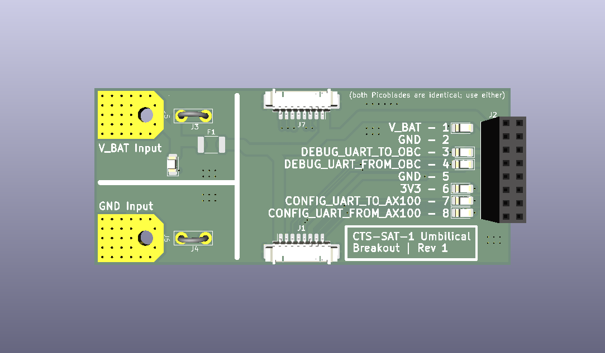
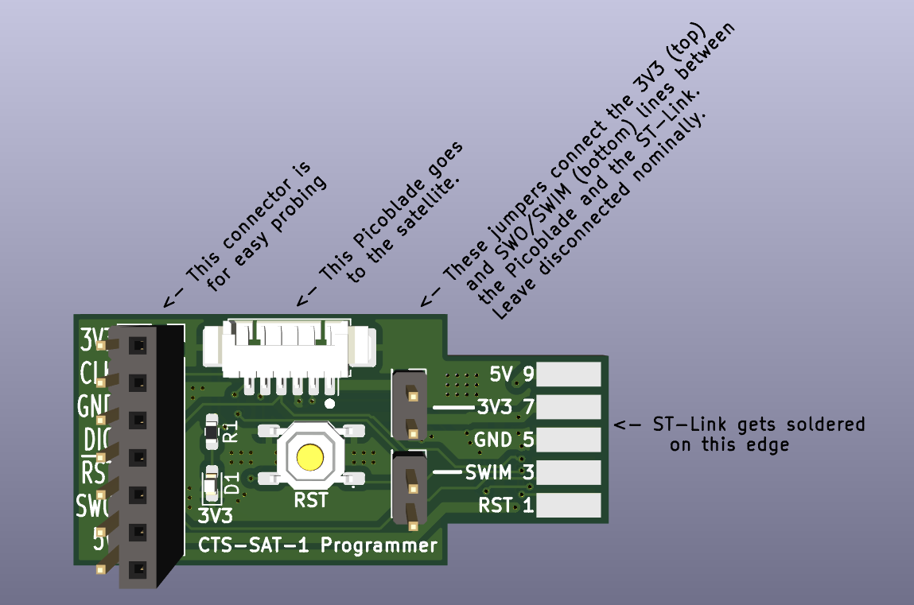
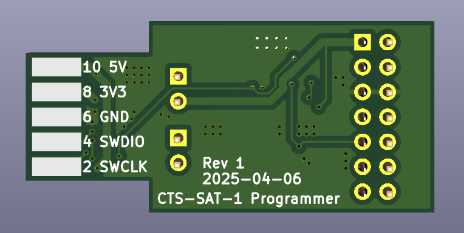

# CTS-SAT-1 Supplemental PCBs

In this folder, two PCBs were used to support the development of the CTS-SAT-1 Onboard Computer (OBC).

* `Programming_Connector_Adapter_PCB`: Solder on to an Aliexpress ST-Link, and connect to the OBC with a 6-wide picoblade harness.
* `CTS-SAT-1-Umbilical-Breakout`: Works as a passthrough, and breaks out each pin for easy connection to USB-UART convert. Adds LEDs to each pin, as well as a polyfuse for safe charging.

## Subfolder Organization

* `./Programming_Connector_Adapter_PCB/` depends on `./lib/`.
* `./CTS-SAT-1-Umbilical-Breakout/` is self-contained.

## Render: `CTS-SAT-1-Umbilical-Breakout`

## Render: `Programming_Connector_Adapter_PCB`

